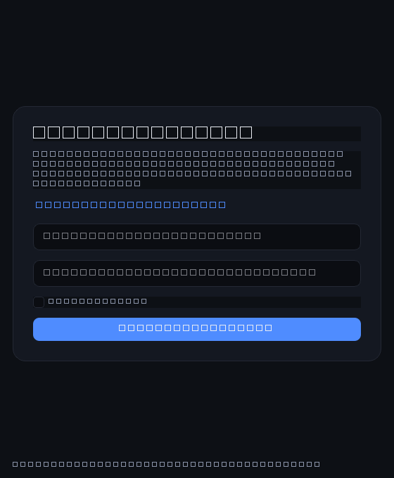

<!-- SPDX-License-Identifier: Apache-2.0
     Copyright (c) 2026 Tarang Patel -->
# tbox

A personal file archive over Telegram Saved Messages: your files live in a
chat only you can read, and a local index remembers what is where.

- **C core** (`src/`) — the engine: tdjson bridge, sessions, later file ops.
- **Python front** (`front/`) — settings, the window you actually use, and a
  command line for power users and debugging.

## Build it (one command)

```powershell
powershell -ExecutionPolicy Bypass -File build.ps1
```

That single command does all of it, in order:

1. builds and tests the C engine (`scripts/build-native.ps1`)
2. copies the engine and its runtime DLLs into the Python package (`tbox/bin/`)
3. installs the front into `.venv`
4. runs the front's tests
5. writes a wheel to `dist/` — the whole app, engine included
6. freezes the desktop app into one file, `dist/tbox.exe`, and runs its
   built-in self-check so a bundle that cannot start fails the build

Needs Visual Studio Build Tools (MSVC via vcvars), CMake, and Python 3.11+.
Step 2 is why one command is enough: the engine stops being a separate thing
you have to find, and becomes part of the app.

Every push and pull request runs the same two gates on Windows — the C
engine plus ctest, then the front's unit tests — in
`.github/workflows/ci.yml`. CI is fully offline: the TDLib runtime and the
SQLite amalgamation are vendored, and the C tests drive a fake TDLib, so no
Telegram account, network access or secret is ever needed.

Working on one half only:

```powershell
powershell -ExecutionPolicy Bypass -File scripts\build-native.ps1   # C engine + ctest
.venv\Scripts\python -m pip install -e "front[gui]"                 # front (editable, with the window)
.venv\Scripts\python -m unittest discover -s front\tests            # front tests
```

The TDLib runtime (`tdjson.dll`, OpenSSL companions, `z.dll`) ships in
`vendor/`. If it goes missing, re-download it with:

```powershell
powershell -ExecutionPolicy Bypass -File scripts\fetch-tdjson.ps1   # Windows
bash scripts/fetch-tdjson.sh                                        # Linux/macOS
```

## Use it

Double-click `dist\tbox.exe`. That is the whole app: window, engine and
TDLib in one file. First run:

1. it asks for your Telegram `api_id` and `api_hash` — free to obtain:
   open <https://my.telegram.org/apps>, create (or open) an application, and
   copy the two values. "Where do I get these?" opens that page for you.
2. it shows a QR code; scan it with your phone:
   **Settings > Devices > Link Desktop Device**
3. if your account has two-step verification, it asks for that password once
   (typed hidden, sent only to Telegram)

then it opens your files. The second run skips everything and goes straight
in, because TDLib keeps the session.



That is the real window running its real code path, with the engine
scripted so no account or phone is needed: the keys screen, the QR (which
refreshes once mid-animation, as it does live), the two-step prompt, then
the files screen with the catalog it read. Regenerate it from the source with
`scripts/make-demo-gif.py` whenever the screens change.

The QR refreshes by itself (roughly every 30 seconds); the window always
shows the newest one, so just keep scanning.

Prefer the command line? The same flow exists there:

```powershell
.venv\Scripts\tbox.exe setup    # asks for your Telegram api_id + api_hash
.venv\Scripts\tbox.exe login    # shows a QR code; scan it with your phone
```

MVP status: `setup`, `login`, `logout`, `ls` and `rescan` exist today. The
archive commands (put, get, move, ...) come next, built on the same engine.

### Where things live

| Path | What it is |
|---|---|
| `%LOCALAPPDATA%\tbox\.env` | your api_id (local only, never committed) |
| your OS secure store (service `tbox`) | the api_hash and the TDLib database key |
| `%LOCALAPPDATA%\tbox\session\` | TDLib's database — deleting it means scanning again |
| `%LOCALAPPDATA%\tbox\index.db` | tbox's own catalog (SQLite); the engine owns it, the UI never opens it |
| `%LOCALAPPDATA%\tbox\logs\` | redacted engine logs |
| `build\` | the compiled engine and its test binaries (gitignored) |
| `front\src\tbox\bin\` | the engine copied into the package by `build.ps1` |
| `dist\tbox.exe` | the app as one windowed file (engine inside) |
| `dist\` | the finished wheel |

### Commands

| Command | What it does |
|---|---|
| `tbox setup` | ask for the Telegram app credentials and save them (api_hash to the secure store) |
| `tbox login` | link this computer (QR; asks for credentials on the first run) |
| `tbox login -v` | same, plus every raw engine event the engine sends |
| `tbox logout` | log out on Telegram (your local data is kept) |
| `tbox ls [folder]` | list what is in a folder: `root` (the default), `inbox`, `trash`, `lost` or a folder id |
| `tbox rescan` | read Saved Messages again, from the oldest message to the newest |
| `tbox --version` | print the version |

The window's Files screen offers the same things: a tree of folders (Root,
Inbox, Trash, Lost & Found), the items of the chosen folder, and a **Rescan**
button. It also offers **Sign out** (keeps local data) and **Remove local
data** (deletes this computer's session and settings — your Telegram account
is never touched). The desktop app has no commands beyond the developer-only
`--selftest` (which the build script uses to check a frozen bundle).

## Troubleshooting

| What you see | What it means |
|---|---|
| `error: API_ID_INVALID (code 400)` | the api_id/api_hash pair is wrong — re-check <https://my.telegram.org/apps> |
| `error: engine not found` | the engine is not built or bundled — run `build.ps1` |
| `error: no Telegram credentials yet` | run `tbox setup` (it only prompts when a terminal is attached) |
| The window says "Something went wrong" | same cause as the error above; "Change the keys" reopens the first-run screen |
| `dist\tbox.exe` starts but no window appears | your antivirus may block a freshly built exe; the same app runs from `.venv\Scripts\tbox.exe login` |
| The QR shows as `##` pairs | your terminal is not UTF-8; set `PYTHONIOENCODING=utf-8` or use Windows Terminal (the window is unaffected) |
| You want to start over | in the app use "Remove local data", or delete `%LOCALAPPDATA%\tbox\session\` and log in again |
| Nothing seems to happen | `tbox login -v` — raw engine events, including connection state |

## How the two halves talk

The engine does the work and reports **state events**; the front decides what
a person sees. No printing, prompting, QR drawing, heartbeats or timeouts
live in C — the front owns all of that, and passes credentials and paths in.

There are two fronts over the same engine: the window (`front/src/tbox/gui/`,
which runs the engine on its own thread so the UI never blocks) and the
command line (`front/src/tbox/cli.py`). Both speak the protocol below and
nothing else, which is why they behave identically.

```
+-------------------------------------------------------------+
| UI  (window and command line)                               |
+--------------------------+----------------------------------+
                           | JSON lines over the child's stdin/stdout
+--------------------------v----------------------------------+
| C engine (tbox-engine serve <profile-dir>)                  |
|   stdio transport -> engine loop (one thread owns all state |
|                      and is the only writer to index.db)    |
|   TDLib receive thread -> event queue -> engine loop        |
+--------------------------+----------------------------------+
                           |
                    TDLib (tdjson) -> Telegram Saved Messages
```

The desktop app starts `tbox-engine serve <profile-dir>` once and keeps it
running (spec §6.1); the front never spawns one engine per command. Only the
C engine touches tdjson. The engine loop is UI-free and transport-pluggable:
it takes commands through one call and emits output through a callback, so
the stdio wrapper is thin and a future embedding would not rewrite it.

### The protocol in one screen

One JSON object per line, UTF-8, newline-terminated. Requests carry an
integer `id` and get exactly one response; anything without an `id` is an
event. All Telegram IDs are sent as **strings** (they can exceed 2^53).

```jsonc
// front -> engine
{"id": 7, "cmd": "auth.start", "args": {"api_id": "35982092", "api_hash": "...", "db_key": "..."}}

// engine -> front: success
{"id": 7, "ok": true, "result": {}}

// engine -> front: error (one of the spec's codes)
{"id": 7, "ok": false, "error": {"code": "BAD_ARGS", "message": "...", "retryable": false}}

// engine -> front: an event, data nested under "data"
{"event": "auth.state", "data": {"state": "WAIT_QR"}}
{"event": "auth.qr", "data": {"link": "tg://login?token=..."}}   // never logged
{"event": "auth.password_needed", "data": {"hint": "..."}}
{"event": "auth.ready", "data": {"display_name": "Your Name"}}
{"event": "auth.closed", "data": {}}
{"event": "conn.state", "data": {"state": "..."}}
{"event": "engine.error", "data": {"code": 400, "message": "API_ID_INVALID"}}
{"event": "cooldown", "data": {"seconds": 42, "reason": "Telegram asked to slow down"}}
{"event": "sync.progress", "data": {"op_id": "…", "messages_scanned": 120}}
{"event": "sync.done", "data": {"op_id": "…", "objects": 12, "inbox_items": 3}}
{"event": "catalog.changed", "data": {"folder_ids": ["*"]}}
{"event": "transfer.progress", "data": {"op_id": "…", "done": 1234, "total": 5678}}
{"event": "transfer.done", "data": {"op_id": "…", "object_id": "…32 hex…"}}
{"event": "transfer.failed", "data": {"op_id": "…", "error": "RETRY_WAIT"}}
```

The commands that exist today are `hello`, `auth.start`, `auth.password`,
`auth.logout`, `engine.status`, `engine.shutdown`, `sync.rescan`,
`catalog.list`, `catalog.stat`, `catalog.summary` and `file.upload`; later
stages add the rest of `file.*`, `folder.*`, `trash.*` and `search.*`
(spec §6.4). `serve` exits `0` on a clean shutdown, `2` when the profile is
already in use, `3` for bad arguments and `4` for a database error.

### Putting a file up

`file.upload` takes a local path and a folder and answers right away with the
id of the operation it started:

```jsonc
{"id": 8, "cmd": "file.upload", "args": {"local_path": "C:\\files\\report.pdf", "folder_id": "root"}}
{"id": 8, "ok": true, "result": {"op_id": "8f3c…"}}
```

The engine checks the file and its size, checks that the name is free in that
folder (`NAME_EXISTS` when it is not), hashes the file, writes the operation
down and then sends the message — one upload at a time, with the progress
reported as `transfer.progress` and the end of it as `transfer.done`. If
Telegram refuses the message the operation waits and tries again; when it
keeps refusing, the operation is `FAILED` and `transfer.failed` says why.

The engine is a child process, so a crash inside TDLib cannot take the front
down with it, and the whole conversation can be logged and replayed.

### The catalog

Your files are Telegram messages. A **managed** file or folder carries a
`tbx1` record in its caption (or, for a folder, in its text):

```text
tbx1 {"v":1,"k":"f","o":"…32 hex…","p":"root","n":"report.pdf","r":2,"s":12345}
```

The record names the object (`o`), its parent folder (`p`), the name (`n`)
and the revision (`r`). A file without a valid record is an **unmanaged
file** and lands in the **Inbox**; a text message without one is a note.
A file that was uploaded also carries its size (`s`), its hash (`h`), its
mtime (`m`) and the id of the operation that sent it (`q`).

The engine reads Saved Messages at startup, writes every message it sees
into `index.db` and derives the folder tree from those rows — always through
the same resolver, so a full scan and a live update can never disagree. After
that it applies the updates Telegram sends as you work, and `sync.rescan`
re-reads the whole history on demand. Nothing is ever deleted from Telegram
as part of reading it.

The engine also keeps a journal of the work it was asked to do, in the `ops`
table of `index.db`, so an engine that stops in the middle of a job leaves a
trail behind. When it starts again it looks at that trail before it takes on
anything new: an operation whose message is already in Saved Messages — its
record carries the id of the operation that sent it — is done and is not sent
a second time; the rest go back into the queue. `engine.status` says how
many are still open.

The upload is the first thing that uses that journal. The checks a file needs
are cheap, so they happen before anything is sent; the message itself is sent
by the engine's runner, one at a time, and the operation moves through
`QUEUED`, `RUNNING`, `SENT` and `DONE` as Telegram takes it. When Telegram
refuses a message the operation waits five seconds, then thirty, then two
minutes, then ten, and only then gives up.

## Security notes

These are the rules the code is held to (spec §5), all of them enforced by
tests rather than good intentions:

- **Secrets never touch disk in the clear.** The `api_hash` and the TDLib
  database key live in your operating system's secure store via `keyring`
  (service `tbox`). Only the non-secret `api_id` stays in `.env`. A legacy
  `TG_API_HASH` line in `.env` is moved into the store on first use, and
  kept in place — with a warning — if the store is unusable, so a credential
  is never lost.
- **Secrets never appear in argv, the environment, logs or crash output.**
  They travel UI → engine only inside a protocol message over stdin. A grep
  test (`scripts/check-no-argv-secrets.ps1`) fails the build if `api_hash`
  ever returns to the command line.
- **The local TDLib database is encrypted.** The front generates 32 random
  bytes once, stores them base64 in the secure store, and sends them in
  `auth.start`. A profile created before this existed is migrated once, after
  `auth.ready`.
- **Logs are redacted.** One `tbox_log_redact()` function is the only way logs
  are written; it strips message text, captions, file names, QR links,
  passwords, keys and phone numbers, keeping only IDs and error codes. It has
  its own unit test.
- **Logout is not deletion.** `auth.logout` calls TDLib's `logOut` — it ends
  the session on Telegram and changes nothing there. "Remove local data" is a
  separate action that deletes this computer's profile directory *after*
  logging out.
- **No network listener exists.** tbox never opens a port.
- **Caption text is data, not code.** Every name that comes from Telegram is
  treated as untrusted before it is written to disk.


## Layout

```
build.ps1            one command -> app
src/                 C engine (cli/, cmd/, engine/, service/, store/, catalog/, sync/, td/)
  cli/               argv parsing + dispatch
  cmd/               command bodies (serve, dev login)
  engine/            the long-running engine loop + protocol
  service/           UI-free session: TDLib params, auth FSM, event queue
  store/             index.db: migrations, meta, pragmas, the catalog tables (SQLite)
  catalog/           pure catalog logic: the tbx1 record, resolve, message parsing
  sync/              turning Saved Messages into the catalog: scan + updates
  util/              log (redaction), rand, fsx
  td/                the only code touching tdjson native symbols
tests/               C tests (ctest gate), including the in-memory fake chat
front/               Python front
  src/tbox/          the package: config, engine_client, secrets_store, qr, cli
  src/tbox/gui/      the window (theme, worker thread, screens)
  packaging/         the freezer: spec, icon drawing, entry point
  tests/             Python tests, including the window (headless)
scripts/             build-native.ps1, fetch-tdjson, fetch-sqlite, check-no-argv-secrets, make-demo-gif.py
.github/workflows/   CI: build C + ctest + Python tests on Windows (offline)
docs/                login-demo.gif, regenerated by scripts/make-demo-gif.py
third_party/cjson    vendored JSON library (MIT)
third_party/sqlite   vendored SQLite amalgamation (public domain)
third_party/sha256   vendored SHA-256 (public domain)
vendor/              prebuilt TDLib runtime
cmake/               tdjson import-lib + staging rules
archive/             earlier designs and plans (local only)
```

## License

Apache-2.0 — see `LICENSE`.